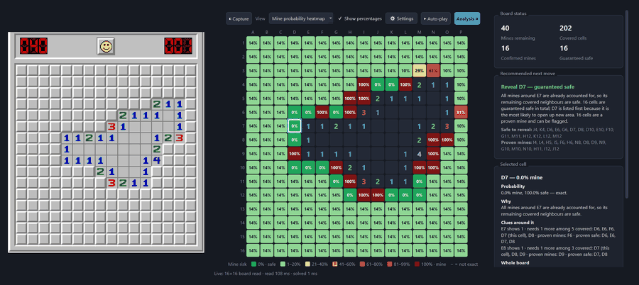
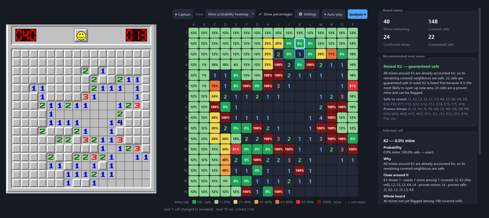

# Minesweeper Probability Solver

Reads a Minesweeper game from your screen, shows the **exact chance that each
cell is a mine**, and tells you where to click next. It can play the safe moves for you.



*A real game on minesweeperonline.com. Left: the game. Right: what the app sees.
After the opening click, every move was the app's choice, and it won in 65 moves.*

## Features

- **Mine probability for every cell**, as a colour heatmap: green is safe, red is a mine.
- **Best next move**, with a plain-English reason.
- **Reads the board live** from any part of your screen.
- **Auto-play** (optional): clicks the safe cells for you; move the mouse to take over.
- **Click any cell** to see why it has that probability.

## Quick start

Windows, Python 3.11+.

```bash
python -m venv .venv
.venv\Scripts\python -m pip install -e .[dev]
.venv\Scripts\minesweeper-solver
```

1. Open a Minesweeper game.
2. Click **Select capture region…** and drag a box around the board.
3. Press **Start** and play. Turn on **▶ Auto-play** if you like.

No game open? Untick "Read board from capture" and type a board in by hand.

## How it works



1. Every number becomes a rule: *"exactly N mines among these covered cells."*
2. Easy deductions come first (like the classic `1-2-1` pattern).
3. Then it counts **every** way the remaining mines could be placed that fits
   all the rules and the total mine count.
4. A cell's probability is the share of those arrangements with a mine on it.
   0% and 100% only appear when they are logically proven.

This is why it beats guessing from the nearest number. In one example, the
nearest number suggests 33% for a cell, but counting every arrangement gives 5.9%.
The full explanation, with worked examples, is in
[docs/how-it-works.md](docs/how-it-works.md).

## Project layout

```
minesweeper_solver/
  core/      probability solver and move recommendation
  vision/    screenshot → board
  capture/   screen capture
  state/     keeps the board in sync between frames
  control/   auto-play
  ui/        the desktop app
tests/       91 tests (python -m pytest)
```

## Notes

- Screen reading and auto-play work on Windows only.
- Tested mostly on the classic look. If a digit shows as `?`, click it and type
  the number to teach the app that digit.
- Some sites don't allow auto-play. Check before using it there.

A just-for-fun project, built with [Claude Code](https://claude.com/claude-code).
MIT [license](LICENSE).
